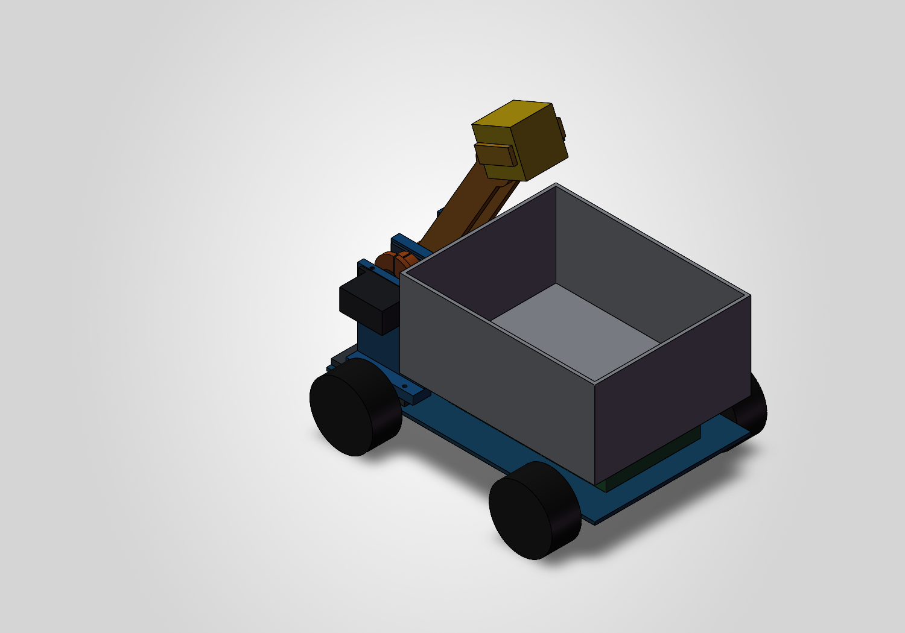

# 最强初生 · CRTC2026 双车机器人项目

## 2026-10-23 当前可用版本

下层车为 **常规四胶轮差速 + STM32F103 + LuatOS ESP32-C3**。入口：[当前接线与操作](docs/16-c3-dashboard-encoders.md)、[Dashboard](firmware/web/dashboard.html)、[C3完整接线台](firmware/web/esp32c3-wiring.html)。

- 已烧录：C3 `crtc-c3-bootquiet-v5`，底盘 `0xC3D91023`；PID/轮向/编码器机械参数由C3 Flash加载并下发，网页修改直接保存C3。
- 大臂IO7、小臂IO6、门IO10；上电无PWM、不恢复参考角度，三路启动/重启零输出已读回，用户确认仅接大臂后不再自动回中。
- 曲线快起快停、编码器启动清零/按钮清零、可信反馈PID辅助与异常读数前馈后备、舵机命名位置/积木和相对路径示教已实现。其他舵机、带载完整行程和路径精度仍需实车验证。
- [已安装镜像、诊断与验收记录](output/bootquiet-encreset-20261023/README.md)；先前S3、双STM32和v3/v4镜像作为历史保留，不能混用端口。

队名：**最强初生**；公开仓库：[Seroliya/zuiqiangchusheng](https://github.com/Seroliya/zuiqiangchusheng)。

**中期考核技术文档（2026-10-19）：[完整正文](docs/14-midterm-report-20261019.md)**。记录 2026-09-16 至 2026-10-19 的功能开发、方案演进、学习与验证过程。

上层车推送黄块，下层车使用翻转臂和夹爪收集、接料。项目背景与当前决策见 [PROJECT.md](PROJECT.md)。

下层车 STM32＋ESP32 双板 UART 与灯控已验证，见 [通信与接线说明](https://github.com/Seroliya/zuiqiangchusheng/blob/7af2521e83984f6dec2a5cd384b27fa92b80138e/docs/lower-car-wiring.md)。独立 [电机与编码器目标](https://github.com/Seroliya/zuiqiangchusheng/blob/7af2521e83984f6dec2a5cd384b27fa92b80138e/docs/06-lower-motor.md) 已实现开环台架输出、四轮 PI 轮速闭环及故障锁存；[ESP32 BLE 与 Android 网页面板](https://github.com/Seroliya/zuiqiangchusheng/blob/7af2521e83984f6dec2a5cd384b27fa92b80138e/docs/08-speed-remote.md) 已实现源码，手机限速 300mm/s、输出限幅 25%。2026-10-17 修复并烧入 `lower-motor`，通过通信、灯控与看门狗诊断测试，见 [修复记录](https://github.com/Seroliya/zuiqiangchusheng/blob/7af2521e83984f6dec2a5cd384b27fa92b80138e/docs/11-lower-watchdog-fix.md)；逐轮架空试转已通过，四轮同时测试触发编码器异常（见电机说明）；实际行驶、闭环调参、手机实连与网页发布仍未验收，四轮校准默认未确认。独立 STM32 `board-link` 目标继续禁用电机。后续按 [四目标半自动方案](https://github.com/Seroliya/zuiqiangchusheng/blob/7af2521e83984f6dec2a5cd384b27fa92b80138e/docs/07-semi-auto-plan.md) 开发里程计和路径，舵机动作仍未实现。上层原 TT/PS2 工程继续使用，不能混用接线。

## 历史机械设计与试验资料

下层车最新建模、底盘、机械机构和料仓已由团队完成，模型文件待补充。以下 v3 是 2026 年 9 月的草案，仅供追溯；当前方案与进度以 [PROJECT.md](PROJECT.md) 为准。

### 翻转臂与料仓 v3（2026-09-21）

根据实物舵机照片补充MG995、SG90外形和安装托架，提供夹取、抬升、投料三个姿态。

- [完整CAD文件包](output/mechanics/flip-arm-sw-v3/FlipArm_V3_photo_fit.zip)
- [投料姿态STEP](output/mechanics/flip-arm-sw-v3/FlipArm_V3_deposit.STEP)
- [SolidWorks装配](output/mechanics/flip-arm-sw-v3/FlipArm_V3_deposit.SLDASM)
- [尺寸、照片依据和修改说明](output/mechanics/flip-arm-sw-v3/README.md)
- [舵机实物参考照片](pic/)

原生文件使用SolidWorks 2026；下载ZIP并完整解压后打开SLDASM，保留同目录零件依赖。其他CAD软件可尝试STEP。当前为装配草案，SG90至夹指的传动、托架至腕部的连接尚未完成，不能把参考舵机和轴承模型作为打印零件。

### 桥梁试验模型

- [带两端高台的完整文件包](output/mechanics/bridge-platforms-v2/Bridge_with_platforms_TEST.zip)
- [带高台STEP](output/mechanics/bridge-platforms-v2/Bridge_with_platforms_TEST.STEP)
- [桥梁模型说明](output/mechanics/bridge-platforms-v2/README.md)
- [单段桥板模型与说明](output/mechanics/bridge-test-v1/README.md)

模型用于150mm桥面通行试验；桥曲线、厚度及净空解释包含假设，不能视为官方场地精确复刻。

## 文件位置

| 目录/文件 | 内容 |
|---|---|
| `output/mechanics/flip-arm-sw-v3/` | 历史舵机照片适配草案 |
| `output/mechanics/flip-arm-sw-v1/`、`flip-arm-sw-v2/` | 历史机械臂版本与生成脚本 |
| `output/mechanics/bridge-platforms-v2/` | 带高台的桥梁装配 |
| `output/power/`、`output/signals/` | 供电与信号方案 |
| `pic/` | 实物尺寸参考照片 |
| `PROJECT.md` | 项目背景、设计决策、工作流程和验收边界 |

CAD目录中的`build.ps1`、`build.cs`为本机SolidWorks API生成脚本；模板和API路径按本机安装配置。重新生成会覆盖相应输出，应先备份并阅读该目录说明。`backups/`、`tmp/`以及BMP预览中间文件作为本地工作资料，新文件不纳入Git。
