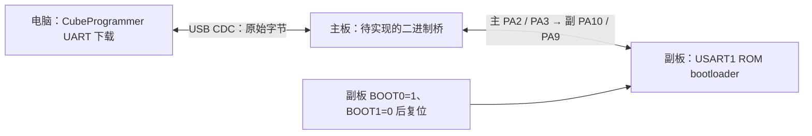

# 双 F103 联动与 USB 烧录方案

更新：2026-10-13。适用 STM32F103C8T6 核心板，先用于两块无外设测试板。

**目前已实现并实测的是：电脑通过主板 USB 发送命令，主板通过串口控制副板用户灯、查询副板身份。两板固件首次下载均使用 ST-Link。USB 经主板烧录副板，以及主板自身的 USB 升级，在本版中均为待实现方案。**

## 1. 功能与代码入口

| 功能 | 本版状态 | 代码或说明 |
|---|---|---|
| 主板 USB CDC 通信 | 已实现；主板 USB 收发已实测 | [主循环与串口](../examples/usb-board-test/main.c)、[USB 描述符](../examples/usb-board-test/usb_descriptors.c) |
| 主板转发、副板应答 | 已实现；PING、UID、LED TOGGLE 简短实测通过 | [请求解析](../examples/usb-board-test/slave_protocol.c)、[电脑联动脚本](../examples/usb-board-test/slave_test.py) |
| 两角色构建与 ST-Link 下载 | 已实现；两板下载校验通过 | [构建脚本](../build_usb_test.py)、[完整教程](../examples/usb-board-test/README.zh-CN.md) |
| 主板 USB 转 UART 烧录副板 | 待实现二进制桥；未实测烧录 | 第 4 节 |
| 主板自身通过 USB 升级 | 待实现 USB bootloader / IAP；未实测 | 第 5 节 |

`host_test.py`、`slave_test.py` 是通信测试脚本，不执行 Flash 擦写。`main.c` 的 `usb_poll()` / `uart_poll()` 处理文本行，当前不能直接转发 CubeProgrammer 的二进制下载协议。

## 2. 当前可以使用的双机联动


| 主板 A | 副板 B | 用途 |
|---|---|---|
| PA2 / USART2 TX | PA3 / USART2 RX | 主板发送请求 |
| PA3 / USART2 RX | PA2 / USART2 TX | 副板返回应答 |
| GND | GND | 共地 |

两板串口均为 **3.3V TTL、115200、8N1**。USB 接主板核心板自己的接口；副板只需独立供电。更换接线前断电，两块板的 3V3 稳压输出不互连；核心板 USB 供电时移除 ST-Link 的供电线，SWD 信号与 GND 可以保留。

在 `sample-mecanum-car-study` 目录中运行，`COM3` 换成实际主板端口：

```powershell
python -m pip install pyserial==3.5
python examples/usb-board-test/host_test.py --list
python examples/usb-board-test/slave_test.py --port COM3 --command 'LED TOGGLE'
```

普通串口工具发送 `LED TOGGLE` 控制主板自身；控制副板则发送：

```text
UART REQ 00000001 LED TOGGLE
```

主板先回复 `OK UART QUEUED`，随后应收到 `UART_RX RSP 00000001 OK LED 1` 或 `0`。只有收到对应编号的副板应答才说明联动成功。协议每行以换行结束，请求编号是非零的 8 位十六进制数。

2026-10-09 已验证主板 UID `02430207505400113638414E`、副板 UID `02040200505400193638414E` 不同，副板灯状态由 0 变 1，本次 UART / USB 错误计数未增加。副板独立 USB 收发尚未单独完成。详情见[实测记录](USB_BOARD_TEST_RESULTS.zh-CN.md)。

## 3. 当前如何烧录

两角色共享应用源码，通过 `build_usb_test.py --role bridge` / `--role slave` 分开构建；依赖版本、安装目录和编译命令见[教程第 4 节](../examples/usb-board-test/README.zh-CN.md#4-重新编译)。生成各自的 HEX 后，用 ST-Link 的 SWDIO→PA13、SWCLK→PA14、GND→GND 下载到对应板。

台架固件使用独立的 [64KiB Flash / 20KiB RAM 链接脚本](../examples/usb-board-test/stm32f103c8.ld)，从 `0x08000000` 启动，至少保留 2KiB 栈；不会改动原底盘固件预留校准页的链接脚本。下载操作只用于指定测试板。

USB CDC 的 COM 口是应用运行后提供的通信口，不能据此判断已有 USB 下载能力。STM32F103C8T6 的 ROM bootloader 提供 USART1 下载接口，没有原生 USB DFU；依据为 [ST AN2606 第 21 节及表 45](https://www.st.com/resource/en/application_note/an2606-stm32-microcontroller-system-memory-boot-mode-stmicroelectronics.pdf)。

## 4. 规划：一个 USB 经主板烧录副板

这一方案的路径是：电脑 USB → 主板二进制桥 → 副板 USART1 ROM bootloader。**本版没有二进制桥实现，以下接线与流程暂不能用于现有测试固件下载。**



| 主板 A | 副板 B | 烧录时作用 |
|---|---|---|
| PA2 / USART2 TX | PA10 / USART1 RX | 发送下载数据 |
| PA3 / USART2 RX | PA9 / USART1 TX | 接收 ACK 与读回数据 |
| GND | GND | 共地 |

**运行时使用副板 PA2/PA3；ROM 烧录使用副板 PA9/PA10。** 应通过换线或选择跳线切换，不能把两个 UART 的 TX 输出并在一起。PA13/PA14 是 SWD，不接受 UART 下载字节。

待二进制桥完成后，计划采用手动流程：

1. 副板 BOOT0 设为 1，BOOT1 / PB2 保持 0，复位副板进入系统存储器。
2. 主板进入二进制桥模式，UART 配置为 115200、8 数据位、偶校验、1 停止位（8E1）。
3. 电脑以 CubeProgrammer 的 UART 模式连接主板 CDC 端口，由该桥把原始字节送到副板。下载、读回校验通过后断开连接。
4. 副板 BOOT0 恢复 0，复位运行应用；主板退出桥模式并恢复 8N1，再切回双机通信接线。

副板接线与进入 ROM 的条件来自 [AN2606](https://www.st.com/resource/en/application_note/an2606-stm32-microcontroller-system-memory-boot-mode-stmicroelectronics.pdf)；偶校验、初始同步字节 `0x7F`、应答 `0x79` 及命令校验来自 [AN3155](https://www.st.com/resource/en/application_note/an3155-how-to-use-usart-protocol-in-bootloader-on-stm32-mcus-stmicroelectronics.pdf)。

后续实现需完成：

- 增加独立桥模式，绕过文本解析与 `UART_RX` 前缀，原样转发包括 NUL、CR、LF 在内的全部字节。
- 处理 USB CDC 的串口配置请求，支持所需波特率与 8E1。F103 开启奇偶校验时，寄存器字长需包含校验位，不能直接照搬当前 8N1 的 `CR1`。
- 用有界队列和流量控制处理双向传输；队列满时保留待发数据，不能把下载数据当作日志丢弃。
- 在模式切换时清空旧的文本状态和缓存；规定超时、退出及恢复步骤。当前优先手动 BOOT0 / 复位，不承诺自动控制这些引脚。
- 实测同步、目标 ID、下载及独立读回一致性，并验证退出后原双机通信可恢复。

已规划的 MG370 底盘中，副板 PA9 同时是 M3 编码器 TIM1 通道。若采用此 ROM 烧录路径，需预留切换接口，在下载时断开编码器对该脚的驱动；不能把编码器信号与 ROM TX 输出直接并接。当前两块无外设测试板没有此冲突。

## 5. 规划：主板也通过自身 USB 升级

主板需要先通过 ST-Link 安装 USB bootloader / IAP，再为 bootloader 和应用分别划定 Flash 区域、调整应用起始地址与向量表，并提供升级入口、长度与校验检查及失败恢复。副板经主板下载，不会自动给主板自身增加这些能力。

本版应用从 `0x08000000` 启动；没有 USB bootloader、应用重定位、Flash 下载指令或升级主机脚本。后续选择并实现具体协议后，再提供对应的可执行烧录教程。

## 6. 与正式底盘方案的关系

主控负责 PS2 / 舵机 / 传感器，副控负责两块驱动板和四轮的分工见[双 F103 接线规划](DUAL_F103_CHASSIS_WIRING.zh-CN.md)。本版先验证同一组 USART2 通信线，副板执行的是灯控命令，尚未实现四轮目标报文、编码器闭环、心跳超时停车或正式底盘控制。
